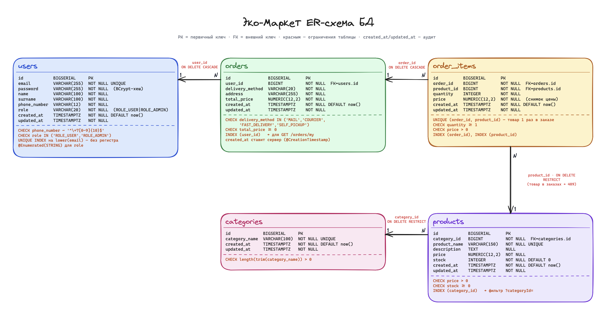

# 🌱 Эко-Маркет

**Эко-Маркет** — backend-приложение интернет-магазина, разработанное на Java 25, Spring Boot и PostgreSQL.

Система позволяет пользователям регистрироваться, просматривать каталог товаров и оформлять заказы, а администраторам — управлять товарами, категориями, заказами и пользователями.

## Запуск через Docker

Нужен Docker с Compose (на Windows — запущенный Docker Desktop с Linux-контейнерами).
Локальные Java, Gradle и PostgreSQL не требуются. Для первой сборки нужен интернет.

Из корня проекта:

```shell
docker compose up --build
```

После запуска приложения Swagger доступен без авторизации по адресу
[http://localhost:8080/documentation](http://localhost:8080/documentation).
Контроллеры пока пустые, поэтому список операций в Swagger будет пустым.

Dockerfile выполняет задачу `test` и собирает JAR в образе Gradle 9.8.2 с JDK 25,
используя `build.gradle.kts`. Приложение работает в отдельном образе Eclipse Temurin 25 JRE.
Compose запускает приложение после успешного healthcheck PostgreSQL.

Сейчас тестовый файл пуст, поэтому тестовые проверки не выполняются.

PostgreSQL использует именованный volume `postgres_data`, который сохраняется
при остановке и пересоздании контейнеров. Однако сейчас `ddl-auto: create`
пересоздаёт таблицы сущностей при каждом запуске приложения и удаляет их данные.
Для сохранения данных между запусками верните `ddl-auto: update`. Остановка:

```shell
docker compose down
```

Не добавляйте `--volumes`, если хотите сохранить данные.
PostgreSQL доступен на `localhost:55432`: база, пользователь и пароль — `ecoshop`.
Эти параметры предназначены для локальной разработки. Внутри Docker приложение
подключается к `postgres:5432`. Оба сервиса публикуются только на `127.0.0.1`;
порт приложения — `8080`.

## 🗄️ Схема базы данных (ERD)

ER-диаграмма (Entity Relationship Diagram) отображает структуру базы данных интернет-магазина «Эко-Маркет», включая таблицы, их поля, типы данных, первичные и внешние ключи, связи между таблицами и ограничения целостности данных.


